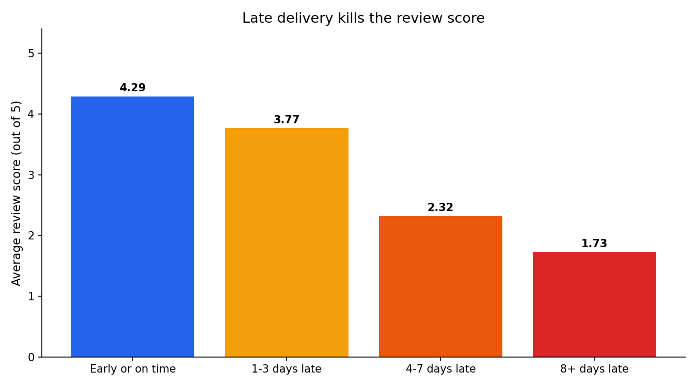
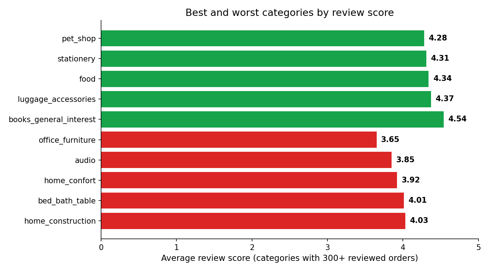
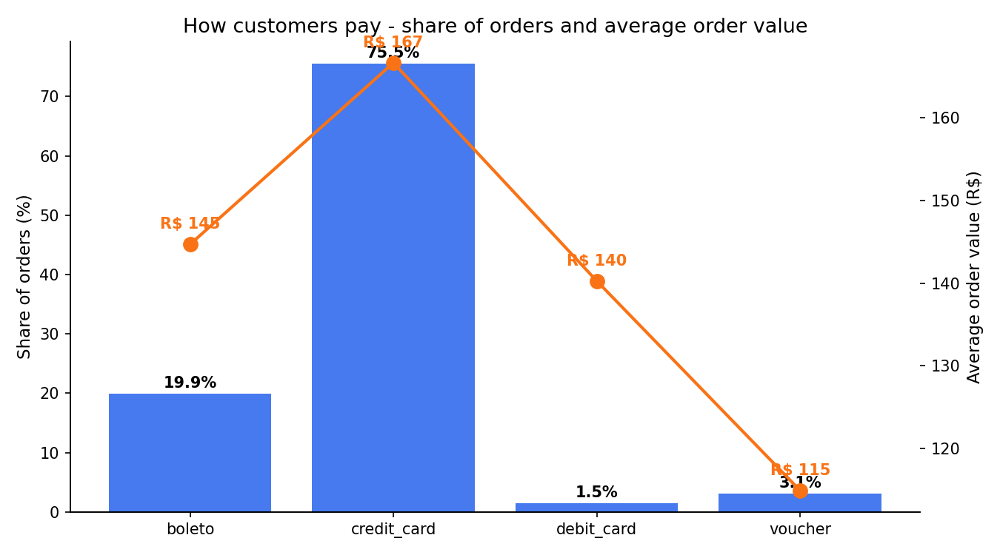
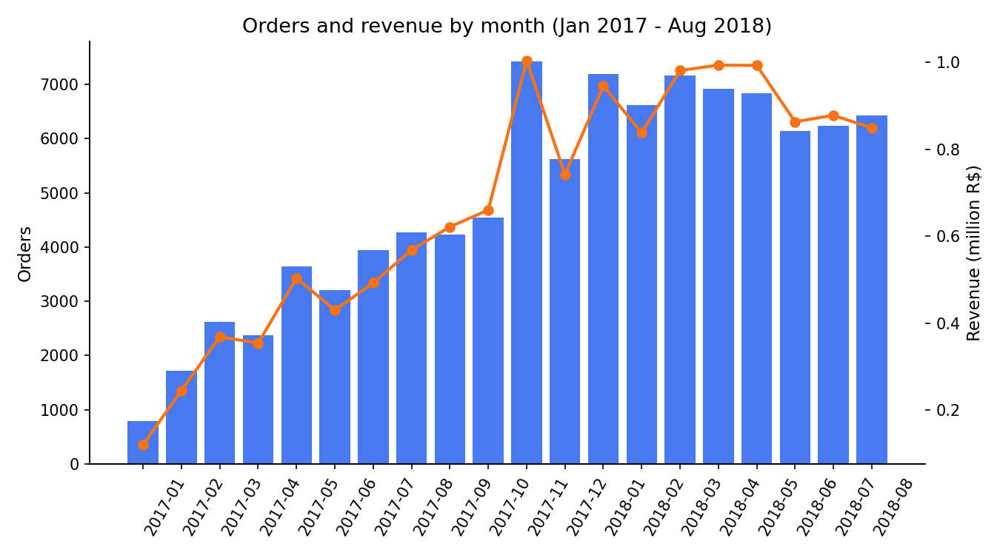
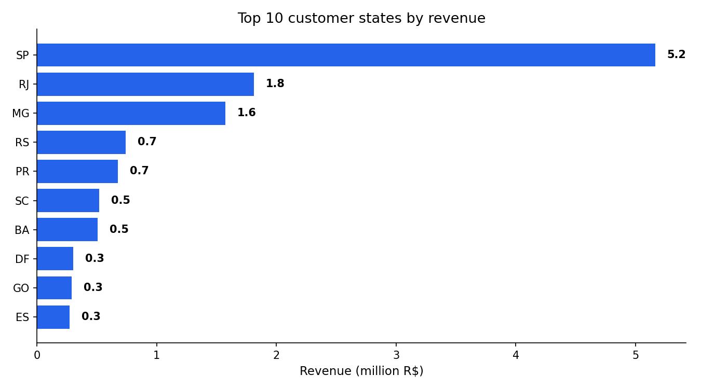
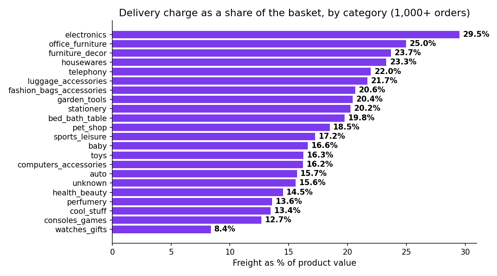

# Olist E-Commerce Analysis — What Makes Customers Happy or Angry? 🇧🇷

Hi, I'm **Vivek Saini** — a Data Analyst from Meerut, India. This is my
third portfolio project. My first two projects used data I created
myself. This time I wanted the real thing.

So this project uses **real data from Olist, a real marketplace in
Brazil** — 99,441 real orders placed between 2016 and 2018,
with what people bought, how they paid, when the parcel reached them,
and the review score they gave after delivery.

> 📓 **Start here:** the full analysis, step by step with charts, SQL
> and commentary, is in **[olist_analysis.ipynb](olist_analysis.ipynb)**.
> The scripts below reproduce everything.

## The question I wanted to answer

> **What makes a customer happy or angry on a marketplace?**

My guess before I touched the data: delivery. A parcel that comes late
should make people angry, and the review score should show it. I tested
that guess, and five more questions:

1. How late are deliveries — and does being late actually hurt the review score?
2. Which product categories earn the most, and which get the best and worst reviews?
3. How do customers pay? Does paying in parts (installments) change how much they spend?
4. How did sales grow month by month, and which states buy the most?
5. Do customers ever come back for a second order?
6. How much of the basket price is eaten by the delivery charge (freight)?

## About the data — it is real

This dataset is **published by Olist itself** on GitHub
([olist/work-at-olist-data](https://github.com/olist/work-at-olist-data))
for public use, under the **CC BY-NC-SA 4.0** licence. The data belongs
to Olist. Only the code in this project is mine.

The `download_data.py` script pulls the tables straight from that page —
no copy-paste, no made-up rows. One honest note: the data was shared by
Olist for a hiring exercise, so customer and seller names are not in it.
The orders, prices, payments, dates and review scores are real.

## The dataset at a glance

| Table | Rows | What it holds |
|---|---|---|
| Orders | 99,441 | status, purchase time, promised and real delivery dates |
| Order items | 112,650 | one row per product: price, delivery charge |
| Payments | 103,886 | card / boleto / voucher, installments, amount |
| Reviews | 99,224 | the 1–5 star score and comment dates |
| Customers | 99,441 | buyer city and state |
| Products | 32,951 | category (in Portuguese, translated by me) |
| Sellers | 3,095 | seller city and state |

After cleaning and joining: **98,666 orders** in one
analysis table (775 orders had no items at all and
could not be used). Delivered orders: 96,478. Period:
2016-09-04 to 2018-09-03 — nearly all sales fall in 2017–2018.

**Cleaning problems I had to fix** (all real): cancelled and
"unavailable" orders mixed in with delivered ones, delivered orders with
no delivery date, a few orders reviewed twice (I kept the latest
review), category names in Portuguese, and orders with items from more
than one category (my rule: the order's category = the category of its
most costly item).

## What I found

### 1. Late delivery is rare — but it kills the review score

Only **8.0%** of delivered orders arrived after
the promised date. The average delivery took 12.6
days, and 92.0% of orders still beat the
promise. But look at what happens when the promise breaks:

| Delivery | Orders | Avg review | 5-star | 1-star |
|---|---|---|---|---|
| Early or on time | 88,163 | 4.29 | 62.4% | 6.6% |
| 1-3 days late | 2,636 | 3.77 | 43.2% | 13.8% |
| 4-7 days late | 1,773 | 2.32 | 18.2% | 53.0% |
| 8+ days late | 3,252 | 1.73 | 7.5% | 68.8% |

On-time orders average **4.29 stars**. Late orders
average **2.57**. At 8+ days late, the average is
**1.73** and 68.8%
of buyers give the worst score. A delay of 1–3 days costs a little.
Past a week, the customer is gone.

**My reading:** the promise matters more than the speed. Olist is slow
but mostly honest — and honest keeps customers happy.



### 2. Categories: money and happiness are different things

Total product sales in the data: **R$ 13.49 million**.

| # | Top categories by revenue | Sales |
|---|---|---|
| 1 | health beauty | R$ 1,256,377 |
| 2 | watches gifts | R$ 1,199,160 |
| 3 | bed bath table | R$ 1,037,532 |
| 4 | sports leisure | R$ 979,414 |
| 5 | computers accessories | R$ 904,519 |

Worst reviews (categories with 300+ reviewed orders):

| Category | Avg review | Orders |
|---|---|---|
| office furniture | 3.65 | 1,241 |
| audio | 3.85 | 341 |
| home confort | 3.92 | 362 |
| bed bath table | 4.01 | 9,095 |
| home construction | 4.03 | 470 |

Best reviews:

| Category | Avg review | Orders |
|---|---|---|
| books general interest | 4.54 | 489 |
| luggage accessories | 4.37 | 1,009 |
| food | 4.34 | 432 |
| stationery | 4.31 | 2,231 |
| pet shop | 4.28 | 1,673 |

Two things stood out. **office furniture** is the worst-rated
category (3.65 stars) — heavy furniture is easy
to damage and slow to move. And **bed bath table**, the
third-biggest earner at R$ 1,037,532, scores only
4.01 — a small quality fix there moves a lot of
money. Books make people happiest: **books general interest** at
4.54 stars.



### 3. How customers pay — and why installments matter

| Payment type | Share of orders | Avg order value | Avg installments |
|---|---|---|---|
| Credit card | 75.5% | R$ 167 | 3.6 |
| Boleto (bank slip) | 19.9% | R$ 145 | 1.0 |
| Voucher | 3.1% | R$ 115 | 1.0 |
| Debit card | 1.5% | R$ 140 | 1.0 |

Credit card is king. And most card buyers split the bill:
**68.0% pay in installments**, and
14.0% split into 8 or more parts. It changes
what they buy — an order paid in parts is worth
**R$ 198** on average, against
**R$ 101** paid at once. Almost double.
Easy credit is not a side detail in Brazil; it is a sales tool.



### 4. Growth, and the one state that runs the show

In 2017-01 the marketplace took
787 orders. By
**2017-11** — the Black Friday month — it took
**7,421 orders** and
R$ 1,003,862 in product sales. In
2018-08, the last full month, it held at
6,421 orders.



And the map is not even close: **SP (São Paulo) alone brings
38.3% of all revenue** (41,125
orders, R$ 5,163,867). RJ is second with
R$ 1,811,623. Protect delivery quality in SP first —
a problem there is a company problem. The rest of the country is the
growth space.



### 5. Almost nobody comes back

Out of **95,420 different customers**, only
**3.1% ever placed a second order.**
96.9% bought once and never returned. The
most loyal customer in the data placed 16
orders. The marketplace is good at winning new customers. It is not
good at keeping them.

### 6. Freight quietly eats small baskets

Across the whole marketplace, delivery charges add up to
**16.6% of the product value**. Per order the
average share is **30.9%**, because
small orders carry heavy delivery charges. In
**35.1% of orders, the delivery charge
is more than 30% of what the product itself costs.**

The hardest-hit categories are **electronics**
(29.5%) and **furniture living room** (26.3%). Note
that office furniture — the worst-rated category — sits in this
high-freight group too (25.0%): high delivery cost and angry
customers in the same place. At the easy end, **watches gifts**
adds only 8.4%, because costly products carry their delivery
charge well.



## What the business should do

1. **Fix the promise before the speed.** Honest delivery dates at
   checkout — a date you can beat beats a fast date you miss. And warn
   the customer early when a delay is coming; a warned customer is
   less angry than a surprised one.
2. **Save the very late orders first.** The
   3,252 orders that ran 8+ days late are
   where the 1-star reviews are born (68.8%
   gave 1 star). A fast support reply and a small coupon for this group
   is cheap next to a public bad review.
3. **Look hard at office furniture.** Worst reviews
   (3.65 stars) plus a 25.0% freight
   share points at product quality, packing or the delivery partner for
   large furniture — not at price.
4. **Show the per-month price on product pages.** Buyers who pay in
   parts spend almost double (R$ 198
   vs R$ 101). Make the installment
   price as visible as the full price.
5. **Protect SP, grow the rest.** SP is 38.3% of
   revenue. Other states are where the growth is.
6. **Bring buyers back.** With a 3.1% repeat
   rate, even a small rise is big money. Start with the happiest
   group — on-time buyers, who give 5 stars
   62.4% of the time — and give them a reason
   to return, like a post-delivery coupon.
7. **Set a free-freight line a little above the average basket.** When
   delivery costs 30%+ of the product price, buyers hesitate. A
   threshold turns that pause into "add one more item".

## Honest limits

- The data **ends in 2018**. It shows how this marketplace behaved
  then, not how it behaves today.
- This is **Brazil, not India**: money is in Brazilian real (R$),
  boleto is a Brazilian bank slip, distances are huge, and the average
  delivery time of 12.6 days reflects that.
- 99.2% of orders in my joined table have a
  review score. The rest could not be used for review questions.
- "The category of an order" is my simple rule (most costly item).
  Orders with items from two categories count once.

## How to run it

```bash
python download_data.py   # 1. pull the real tables from Olist's GitHub
python analysis.py        # 2. join + clean, findings.json, 6 charts, SQLite db
python build_notebook.py  # 3. rebuild and run the notebook
```

Then open `olist_analysis.ipynb` to read the full story. The notebook
also runs the main questions again in **SQL** (SQLite) — 6 queries with
joins across orders, items, payments, reviews and customers.

## Tools used

Python · pandas · SQL (SQLite) · matplotlib · Jupyter

---

*Data: **Olist** — real Brazilian marketplace data, published by Olist
under [CC BY-NC-SA 4.0](https://creativecommons.org/licenses/by-nc-sa/4.0/),
source: https://github.com/olist/work-at-olist-data*

*Code: MIT licence, © 2026 Vivek Saini — see [LICENSE](LICENSE).*
